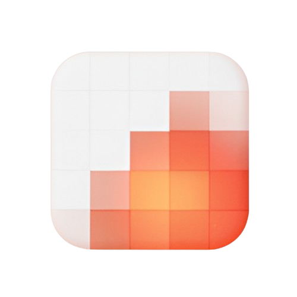

<p align="center">
  
</p>

<h1 align="center">MockIA</h1>

<p align="center">
  <strong>Dibuja pantallas Material 3 Expressive en el navegador, enlázalas, navega entre ellas y copia un prompt para tu herramienta de IA favorita.</strong>
</p>

<p align="center">
  <a href="LICENSE"></a>
  
  
  
</p>

Funciona con cualquier herramienta de IA que reciba un prompt (Claude Code, Codex, Gemini CLI, Cursor, etc.): copia el prompt generado, pégalo en la herramienta y pídele que construya la app.

## Qué hace

- **Componentes arrastrables** – botones, FABs, chips, barras de navegación, tabs, campos de texto, listas, diálogos, tarjetas y más, siguiendo Material 3 Expressive.
- **Navegación entre pantallas** – da a cualquier botón o destino un objetivo y una transición; en la vista previa puedes tocar y navegar de verdad.
- **Tema completo** – color, forma, tipografía y movimiento en un solo panel, con modo claro/oscuro y niveles de contraste.
- **Prompt automático** – todo el diseño (o solo una pantalla) se convierte en un prompt claro para pedirle a una IA que genere el código.
- **Ayudante de IA opcional** – usa tu propia clave (OpenAI, Claude, Gemini o DeepSeek) para redactar descripciones. La clave se guarda solo en tu navegador.
- **Todo se guarda localmente** – no hay servidor ni cuentas; el proyecto vive en el `localStorage` del navegador.

## Uso

```bash
npm install
npm run dev        # http://localhost:3000
npm run build      # exporta el sitio estático a ./out
```

Para publicar bajo una sub-ruta (por ejemplo GitHub Pages), define `NEXT_PUBLIC_BASE_PATH=/tu-repo` al compilar.

## Créditos

MockIA parte del proyecto de código abierto [M3E Canvas](https://github.com/lnkiai/m3e-canvas) (MIT). El indicador de carga y sus formas provienen de [material-components-android](https://github.com/material-components/material-components-android) (Apache-2.0); ver [NOTICE](NOTICE). Los iconos son [Material Symbols](https://fonts.google.com/icons) (Apache-2.0).

## Licencia

MIT — ver [LICENSE](LICENSE).
